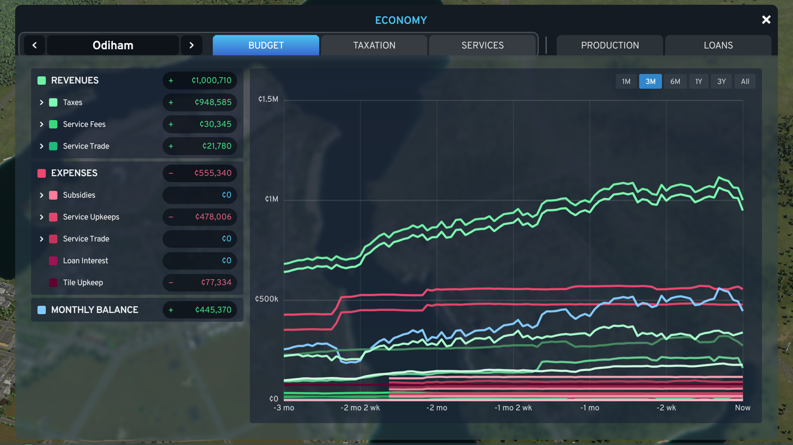
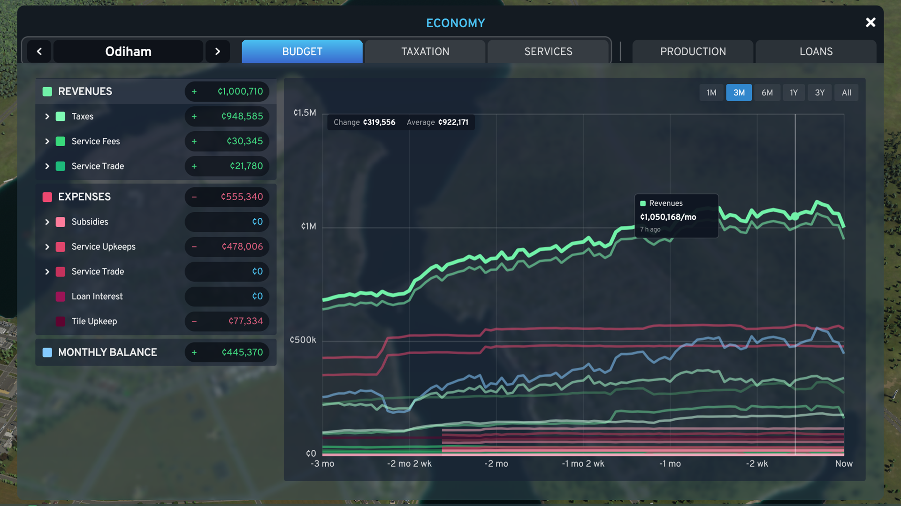
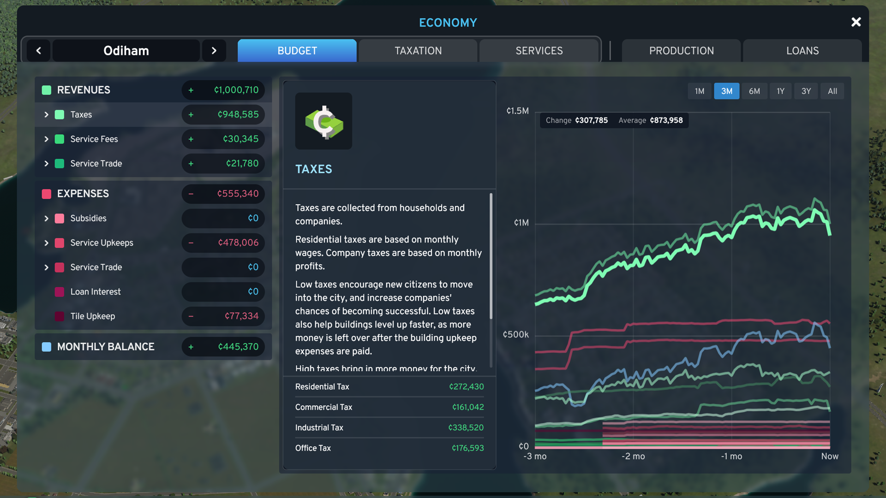
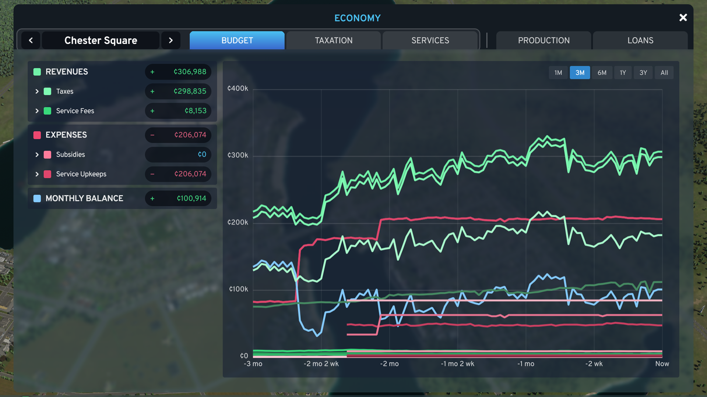
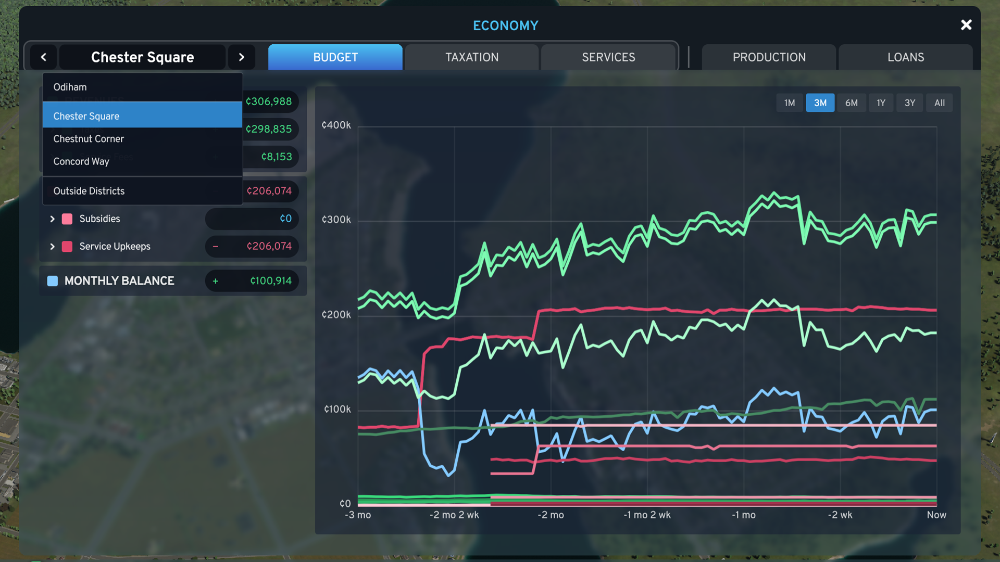
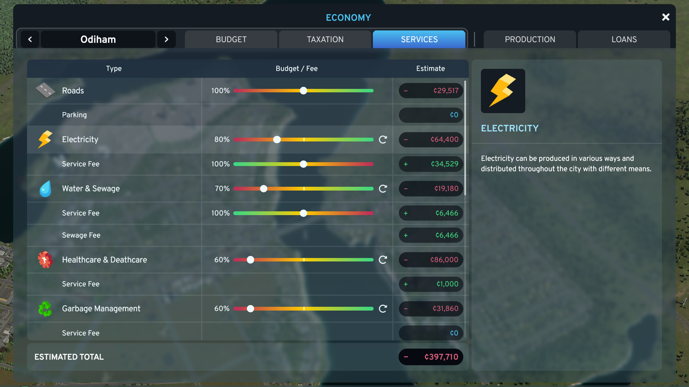
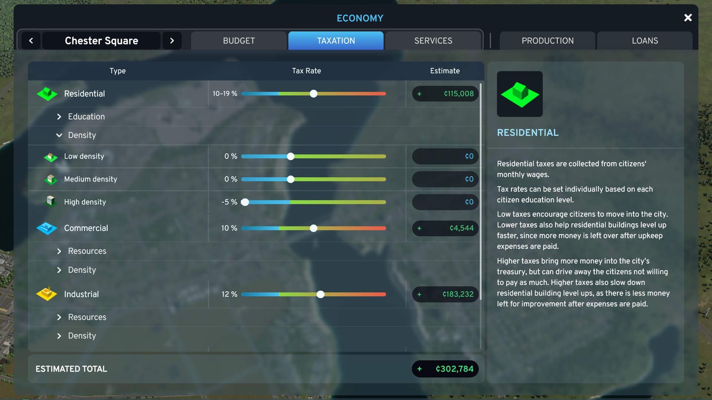
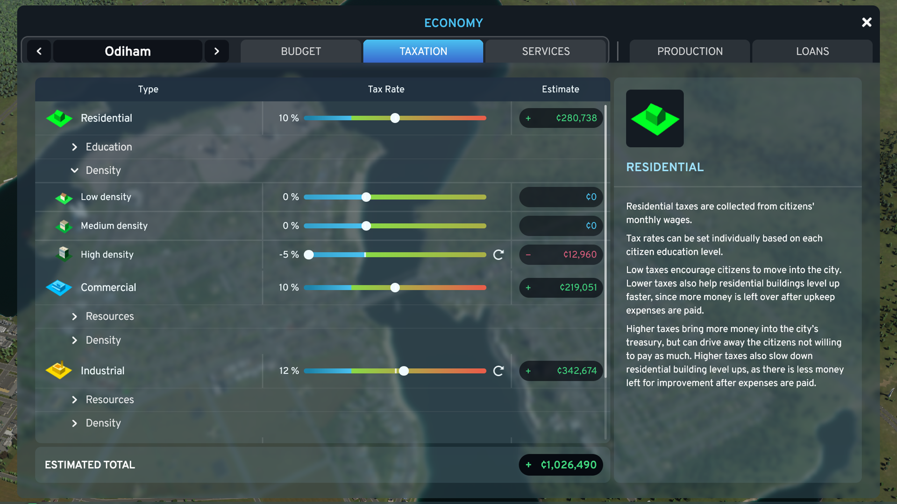
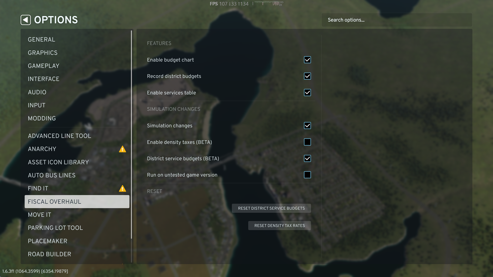

# Fiscal Overhaul

A Cities: Skylines II mod that reworks the Economy panel: a line chart of your city's budget history in place of
the Budget tab's bar chart, a Services tab that shows what each service costs and earns, and tax rates per district,
all driven by one district picker. Optional beta features add density taxes and per-district service budgets.



## Features

### One district picker for three tabs

- A **district picker** at the left of the Economy panel's tabs, framed together with **Budget, Taxation and
  Services**, the tabs it drives: Entire City (shown as your city's name), each of your districts, or Outside
  Districts (everything not in a district).
- Step through with the arrows, or click the name to pick from the list. The choice carries across the three tabs.

### Budget tab: a line chart of your budget history

- **One large line chart** of total revenue, total expenses, the monthly balance and any single budget item
  (residential tax, electricity, healthcare, ...), each as a per-month rate, the same figure the vanilla panel shows.
- **Series filters:** click a row on the left to show or hide its line; ticking a group turns its items on or off
  together. Only the items your city actually has are listed.
- **Time span:** 1 month, 3 months, 6 months, 1 year, 3 years or all history. The history is the game's own
  per-source budget statistics, which it already keeps in your save, so a city you load shows everything back to its
  founding, not just what happened since you installed the mod.
- **Exact values on hover:** the tooltip shows the hovered line's value for that month (for example "¢57,466/mo")
  and how long ago it was, with the span's change and average at the top of the chart.
- **The vanilla detail panel:** hovering a budget item row pops out the game's own breakdown of that item by source.
- **Per-district budgets:** pick a district to see what its buildings pay in taxes, at its own rates, and its share
  of service fees and upkeep by use. City-wide items (loan interest, map tile upkeep, service trade, subsidies) show
  under the whole city only. District history is recorded from the first time the mod runs on a save, 32 times a
  month, and kept in the save.









### Services tab: costs and fee revenue in one table

- **A table like the Taxation tab:** one row per service with its **budget slider** and its **cost** (upkeep and
  imports), and a row under it for each **fee** with its **revenue**. Electricity and Water fees have their sliders
  right there.
- **Estimated total** at the bottom: the rows add up to it.
- **Reset buttons and markers:** each slider shows where its default is, and a button puts it back.
- **The game's info column** at the right explains whatever you hover: a service, its budget (with the efficiency it
  gives) or a fee's effects.
- Prefer the vanilla tab? Turn off **Enable services table** in Options.



### Taxation tab: tax rates per district

- **Per-district tax rates:** pick a district (or Outside Districts) in the header and set its own rates, each zone
  with its education levels and resources. A district without its own rate follows the city's, and the estimates
  show what the district brings in.
- Demand, happiness and the homes households choose react to a district's rates as to the city's.
- **Reset buttons and markers** on every row: a district's row goes back to the city's rate, the city's to the game's
  default.



### Density taxes (BETA)

A beta feature, **off by default**: turn it on with **Enable density taxes (BETA)** in Options > Fiscal Overhaul.

- A **density tax** per zone and building density (residential low / medium / high, commercial low / high, office
  low / high, industrial), from −5% to +10%, paid on top of income tax. The city and each district can set their own.
- Demand, happiness and households choosing homes react to it as to any tax, and the Taxation tab estimates what each
  density rate brings in.



### District service budgets (BETA)

A beta feature, **off by default**: turn it on with **District service budgets (BETA)** in Options.

- Each district (and Outside Districts) can run a service at its **own budget**, from 50% to 150%, changing that
  district's service buildings' efficiency and upkeep. Districts without one follow the city slider.
- Set them on the Services tab with the district picker; the table then shows that district's costs and fee revenue.

## Options

The mod has its own page in the game's Options menu, in three groups:

- **Features**, which change only what you see:
  - **Enable budget chart** (default on). Off, the Budget tab is the vanilla one.
  - **Record district budgets** (default on). Off, nothing new is recorded; what was recorded is kept.
  - **Enable services table** (default on). Off, the Services tab is the vanilla one.
- **Simulation changes**, which change how the game plays:
  - **Simulation changes** (default on), the master switch. Off, the game charges its own taxes again (no district
    or density tax rates) and every service building follows the city's budget slider; your rates and settings are
    kept, and the switches below are greyed out.
  - **Enable density taxes (BETA)** and **District service budgets (BETA)** (both default off).
  - **Run on untested game version** (default off). The mod's tax charging is checked against specific game
    versions; on any other, taxes stay vanilla (the Taxation tab says so) unless you tick this.
- **Reset**: district service budgets, and density tax rates, each after a confirmation.



## Install

Subscribe to **Fiscal Overhaul** on [Paradox Mods](https://mods.paradoxplaza.com/games/cities_skylines_2), from the
website or from the in-game Paradox Mods browser, then enable it in your playset. It is a code mod and needs no other
mods or DLC.

## Compatibility

- **Game version:** 1.6.x (built and tested on 1.6.3f1).
- **Other mods:** Fiscal Overhaul replaces the Economy panel's vanilla Budget and Services pages and extends its
  Taxation tab and tab bar. Another mod that replaces any of those may conflict with it: one of the two will win. Mods
  that change how households and companies are taxed may interact with the district and density tax rates.
- **Saves:** the mod keeps its district history, the tax rates it sets and the district service budgets in your save.
  Removing the mod is safe: the save still loads (the game skips the mod's data), and the city goes back to the
  vanilla panel, vanilla taxes and the city's service sliders.

## FAQ

**My new city's chart is short. Is something wrong?**
No. The chart can only show history the game has recorded; a new city starts with none, and the longer spans fill
in as months pass.

**Why is a district's chart shorter than the city's?**
The game keeps budget history only for the whole city. The mod records each district's from the first time it runs on
a save, so district charts start then.

**Do district and density tax rates change demand or happiness?**
Yes: the game reacts to them as to its own tax rates, for the buildings and households they apply to. Turn off
**Simulation changes** in Options to go back to the game's own taxes at once; your rates are kept.

**Why are expenses drawn above zero?**
So you can compare them with revenue on one axis. The monthly balance line can go below zero, and the zero line is
drawn brighter.

**How do I turn off part of the mod?**
Each tab has its switch in the mod's Options page (**Enable budget chart**, **Enable services table**), and
**Simulation changes** turns off everything that changes how the game plays. Each restores the vanilla behaviour.

## Bug reports and suggestions

Please open an issue on [GitHub](https://github.com/DarrenGKelly/fiscal-overhaul/issues). It helps to include your
game version, the mod's version, your other code mods, and the mod's log (`Logs/FiscalOverhaul.Mod.log` in the game's
user data folder, `%USERPROFILE%\AppData\LocalLow\Colossal Order\Cities Skylines II`).

## Support

If you enjoy the mod and want to say thanks, you can
[buy me a coffee on Ko-fi](https://ko-fi.com/darrengkelly). Entirely optional: the mod is and stays free.

## Building from source

You need Cities: Skylines II with its modding toolchain installed (Options > Modding in the game), the .NET SDK and
Node.js. Then, from the repository root:

```powershell
./tools/build.ps1 -NoDeploy   # compile the mod and type-check the UI
./tools/test.ps1              # unit tests (xunit and vitest)
./tools/build.ps1             # build and deploy into the game's Mods folder (with the game closed)
```

Contributing: see [CLAUDE.md](CLAUDE.md) and [knowledge/](knowledge/index.md), which describe the layout, the
game's code and UI, the traps, and how changes are tested.

## License

[MIT](LICENSE), copyright (c) 2026 Darren Kelly. See [CHANGELOG.md](CHANGELOG.md) for the release history.
