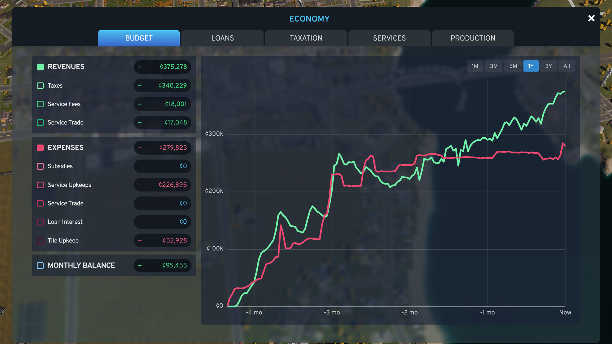
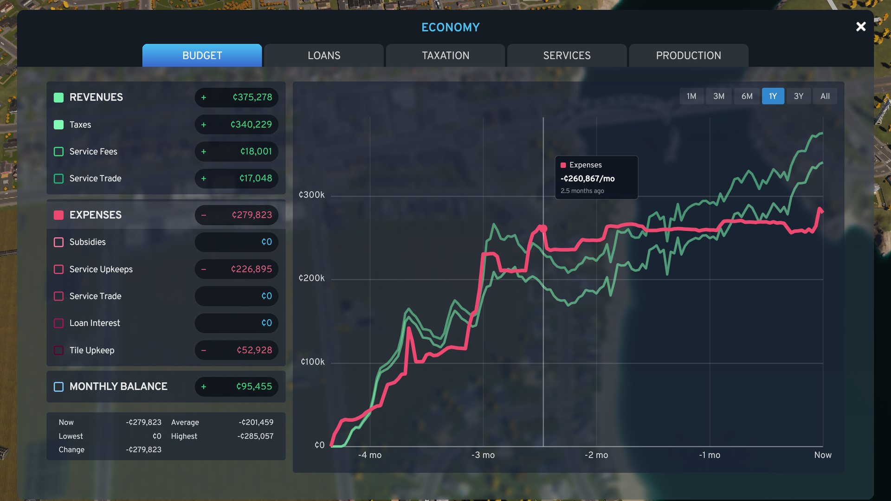
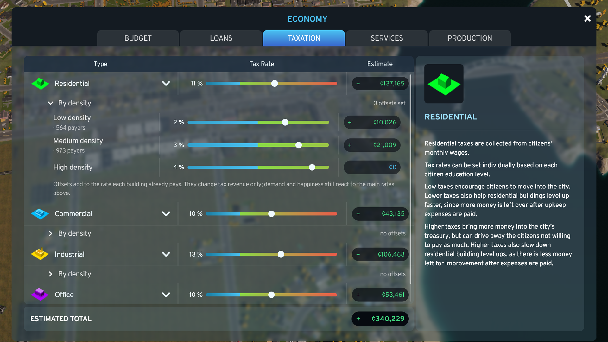
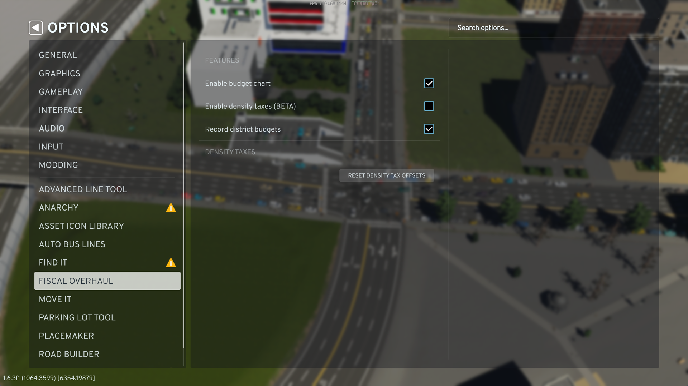

# Fiscal Overhaul

A Cities: Skylines II mod that reworks the Economy panel: a line chart of your city's budget history in place of
the Budget tab's bar chart, and tax offsets by building density on the Taxation tab.



## Features

### Budget tab: a line chart of your budget history

- **One large line chart** of total revenue, total expenses, the monthly balance and any single budget item
  (residential tax, electricity, healthcare, ...), each as a per-month rate, the same figure the vanilla panel shows.
- **Series filters:** click a row on the left to show or hide its line. Only the items your city actually has are
  listed.
- **Time span:** 1 month, 3 months, 6 months, 1 year, 3 years or all history. The history is the game's own
  per-source budget statistics, which it already keeps in your save, so a city you load shows everything back to its
  founding, not just what happened since you installed the mod.
- **Exact values on hover:** the tooltip shows the hovered line's value for that month (for example "¢57,466/mo")
  and how long ago it was. Under the rows, the selected span's now / average / low / high / change for the hovered
  line or row.
- **The vanilla detail panel:** hovering a budget item row pops out the game's own breakdown of that item by source.



### Taxation tab: tax offsets by density

- Under each zone, an offset per building density, added on top of the vanilla rate: residential low / medium /
  high, commercial low / high, office low / high, and industrial.
- Each offset is capped at ±5 percentage points, and the tab shows an estimate of the extra (or lost) revenue per
  month.
- **Income only:** an offset changes the tax a building pays, not demand or happiness. The vanilla zone rates keep
  doing that job.



## Options

The mod has its own page in the game's Options menu:

- **Enable budget chart** (default on). Turned off, the Budget tab is the vanilla one.
- **Enable density taxes** (default on). Turned off, the Taxation tab is the vanilla one and every building pays the
  vanilla rate.
- **Reset density tax offsets**: sets every density offset back to 0, after a confirmation.



## Install

Subscribe to **Fiscal Overhaul** on [Paradox Mods](https://mods.paradoxplaza.com/games/cities_skylines_2), from the
website or from the in-game Paradox Mods browser, then enable it in your playset. It is a code mod and needs no other
mods or DLC.

## Compatibility

- **Game version:** 1.6.x (built and tested on 1.6.3f1).
- **Other mods:** Fiscal Overhaul replaces the Economy panel's vanilla `BudgetPage` and extends its `TaxationGroup`.
  Another mod that replaces either of those may conflict with it: one of the two will win. Mods that change how
  households and companies are taxed may interact with the density offsets.
- **Saves:** the mod stores nothing in your save. The budget history is the game's own statistics, and the density
  offsets are a global mod setting. Removing the mod is safe: the city goes back to the vanilla panel and the vanilla
  tax rates.

## FAQ

**My new city's chart is short. Is something wrong?**
No. The chart can only show history the game has recorded; a new city starts with none, and the longer spans fill
in as months pass.

**Why are my density offsets the same in every city?**
They are a mod setting, not part of the save, so they apply to every city you play. Per-save offsets may come in a
later version. Use **Reset density tax offsets** in Options to clear them.

**Do the density offsets change demand or happiness?**
No. They change only the tax revenue the city collects; demand and happiness follow the vanilla zone rates.

**Why are expenses drawn above zero?**
So you can compare them with revenue on one axis. The monthly balance line can go below zero, and the zero line is
drawn brighter.

**How do I turn off one half of the mod?**
Use **Enable budget chart** or **Enable density taxes** in the mod's Options page. Each restores the vanilla
behaviour for its tab.

## Bug reports and suggestions

Please open an issue on [GitHub](https://github.com/DarrenGKelly/fiscal-overhaul/issues). It helps to include your
game version, the mod's version, your other code mods, and the mod's log (`Logs/FiscalOverhaul.Mod.log` in the game's
user data folder, `%USERPROFILE%\AppData\LocalLow\Colossal Order\Cities Skylines II`).

## Building from source

You need Cities: Skylines II with its modding toolchain installed (Options > Modding in the game), the .NET SDK and
Node.js. Then, from the repository root:

```powershell
./tools/build.ps1 -NoDeploy   # compile the mod and type-check the UI
./tools/test.ps1              # unit tests (xunit and vitest)
./tools/build.ps1             # build and deploy into the game's Mods folder (with the game closed)
```

Contributing: see [CLAUDE.md](CLAUDE.md) and [knowledge/](knowledge/index.md), which describe the layout, the
game's code and UI, the traps, and how changes are tested.

## License

[MIT](LICENSE), copyright (c) 2026 Darren Kelly. See [CHANGELOG.md](CHANGELOG.md) for the release history.
